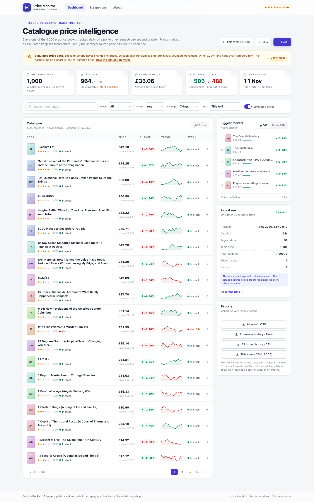
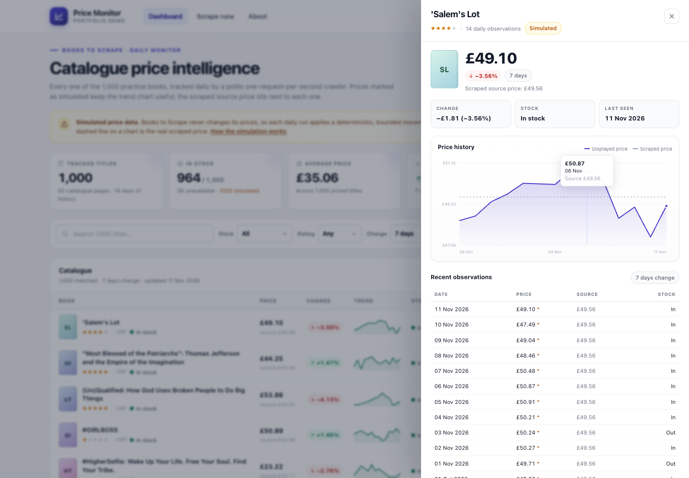
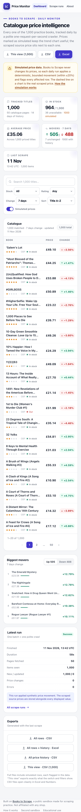
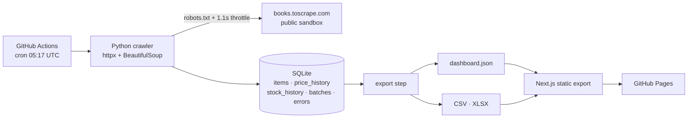

# Price Monitor Demo

A small, honest price-monitoring demo built for a freelance portfolio: a polite
Python crawler stores daily observations in SQLite, and a static Next.js
dashboard turns them into searchable prices, trend charts, movers, and CSV/Excel
exports.

It scrapes **only** [Books to Scrape](https://books.toscrape.com/), a public
sandbox created for scraping practice. No real shops, accounts, credentials, or
anti-bot bypasses are involved.



## What it demonstrates

- **Polite crawling** of all 1,000 books across 50 catalogue pages: robots.txt,
  1.1 seconds between requests, clear User-Agent, bounded retries, and per-page
  error isolation. A bad page is recorded and the crawler skips to the next page
  when the pagination pattern allows, so one 503 does not abandon the rest of
  the catalogue.
- **SQLite storage** with current state plus append-only `price_history`,
  `stock_history`, `batches`, and `scrape_errors` tables.
- **A static dashboard** with search, stock/rating filters, 1/7/30-day change
  windows, generated cover art, sparklines, an interactive price chart, biggest
  movers, batch history, and the exact time/count of the latest scrape. A toolbar
  switch flips the whole view between simulated and real scraped values.
- **Downloads** that open in Excel/Numbers: current prices CSV, items + history
  XLSX, a price-history CSV, and a browser-generated CSV of the current filtered
  view.
- **A daily GitHub Actions job** that scrapes, commits the updated database and
  reports, rebuilds the static site, and deploys it to GitHub Pages for free.
- **Clearly-labelled simulation** for price/stock movement, because the practice
  site's real prices never change. Every synthetic value is flagged in the
  database and in the UI.

### Screens

| Item detail | Mobile |
| --- | --- |
|  |  |

More: [scrape runs](docs/screenshots/batches.png) · [how it works](docs/screenshots/about.png)

## Stack and why

| Choice | Why |
| --- | --- |
| **Python + httpx + BeautifulSoup** | The target pages are plain server-rendered HTML, so a browser automation tool would add cost and fragility for no benefit. Python keeps parsing, SQLite, and the Excel export in one well-tested toolchain. BeautifulSoup's pure-Python parser installs reliably on any Python 3.11+ without native wheels; 1,000 records are tiny. |
| **Next.js static export** | A dashboard that is a set of static files can be hosted for free on GitHub Pages with no server, database connection, or vendor account. Streamlit would be faster to prototype but requires a running process and a hosting account; this also makes a stronger portfolio artifact. |
| **SQLite committed to the repo** | GitHub Pages is static, so the daily job needs the previous days' history available in the checkout. Committing the demo database keeps history across runs with zero infrastructure. For a long-lived production system, prune old rows or move the database to managed storage. |
| **Hand-built SVG chart** | No chart library is needed for one line chart and 14-day sparklines; it keeps the bundle small and the interaction accessible. |

## Architecture



A run is one **batch**:

1. Fetch `robots.txt` once per host and obey it.
2. Crawl the paginated listing, reusing one HTTP client so the global throttle
   applies across pages.
3. Parse each card into a `ParsedItem`; malformed cards become warnings, not a
   crashed run. If a whole page fails, the error is recorded and the crawler
   resumes at the next page where the source's page pattern makes that possible;
   the batch is marked `partial`. After five consecutive unreadable pages it
   stops that source rather than hammering a broken site.
4. Upsert by stable `external_id` and append one price and stock observation per
   item per batch.
5. Record the batch outcome (`success`, `partial`, `failed`) and any errors.
6. Export static data and reports. The web app never talks to SQLite.

## Quick start

Prerequisites: Python 3.11+, [uv](https://docs.astral.sh/uv/), Node.js 20.9+,
[pnpm](https://pnpm.io/), and `make` (or run the commands manually).

```bash
git clone <your-repo-url> price-monitor-demo
cd price-monitor-demo
make demo
```

`make demo`:

1. installs the Python and Node dependencies,
2. scrapes all 50 pages (~1 minute at 1 request/second),
3. exports `dashboard.json`, CSV, and XLSX,
4. builds the static site,
5. serves it at <http://127.0.0.1:3000> and opens a browser.

Useful variants:

```bash
SKIP_SCRAPE=1 make demo                               # rebuild from the committed DB
SCRAPE_ARGS="--max-pages 5 --simulate --ensure-history 7" make demo
PORT=4000 make demo
```

### Manual steps

```bash
uv sync
uv run price-monitor scrape --simulate --ensure-history 14
uv run price-monitor export
cd web
pnpm install --frozen-lockfile
pnpm build
pnpm preview        # http://127.0.0.1:3000
```

For dashboard development with hot reload:

```bash
uv run price-monitor export
make dev            # next dev
```

The dashboard fetches `web/public/data/dashboard.json`, so re-run `export` after
a scrape to see new data in dev.

### Commands

```
price-monitor scrape [--source books|quotes] [--max-pages N] [--simulate]
                     [--ensure-history DAYS] [--db PATH] [--min-interval SEC]
price-monitor export [--db PATH] [--web-dir PATH] [--source books]
```

## Data model

| Table | Purpose |
| --- | --- |
| `items` | One row per unique product: title, URL, rating, currency, scraped price, displayed price, real vs simulated stock, first/last seen. Unique on `(source_key, external_id)`. |
| `price_history` | One row per item per batch: displayed price, real source price, currency, simulated flag, timestamp. Unique on `(item_id, batch_id)`. |
| `stock_history` | Same shape for availability, including real and displayed stock state. |
| `batches` | One row per scrape or backfill: kind, mode, status, pages, items seen/new/updated, price/stock changes, errors, notes. |
| `scrape_errors` | Batch, URL, kind (`fetch`, `parse`, `robots`, `store`, …), message, timestamp. |

`price` is what the dashboard shows. `source_price` is always the value scraped
from the site. When simulation is on, the two differ and `simulated = 1`.

## Simulated data, explained

Books to Scrape never changes its prices, so a real trend chart would be a flat
line. With `--simulate`:

- each item gets a deterministic daily move (seeded by item + UTC date),
- the displayed price is clamped to ±20% of the scraped price,
- about 3% of in-stock titles are shown as unavailable (also flagged),
- `--ensure-history 14` fills missing recent days with synthetic backfill batches
  (`kind = backfill`) so a fresh checkout has a meaningful chart,
- every affected row is marked `simulated`, the UI shows an amber **Simulated
  price data** banner, and charts draw the real scraped price as a dashed line.

The **Simulated prices** switch in the toolbar flips the entire dashboard to the
real scraped values and back, so the difference is visible rather than hidden.
Run without `--simulate` and the dashboard starts in real mode, with a note that
the sandbox prices are static. Backfill never changes current item state.

## Politeness and scope

- **Allowlist:** only `books.toscrape.com` and `quotes.toscrape.com` are
  permitted by code. Any other host is refused before a request is sent.
- **robots.txt:** fetched once per host. Both sandboxes currently return 404,
  which RFC 9309 treats as "no restrictions"; a `Disallow` or unavailable
  robots file blocks the crawl (and is recorded as a batch error).
- **Rate limit:** at least 1.1 seconds between requests, shared across pages,
  retries, and redirect hops. This is intentionally slightly under one request
  per second.
- **Retries:** timeouts, connection errors, 429, and 5xx are retried with
  exponential backoff (and `Retry-After` when present), capped at 3 retries.
- **User-Agent:** descriptive demo UA. Replace the `example.com` URL in
  `price_monitor/config.py` (or set `PRICE_MONITOR_USER_AGENT`) with your repo or
  contact before using this pattern anywhere else.
- **No bypasses:** no CAPTCHA solving, fingerprint spoofing, login, or private
  data. This project would not be pointed at a real commercial site.
- **Preview server:** `scripts/serve.mjs` binds only to `127.0.0.1` and returns
  HTTP 400 for malformed percent-encoded paths instead of crashing.
- **Spreadsheet-safe exports:** text from the scraped page that starts with
  `=`, `+`, `-`, `@`, tab, or carriage return is prefixed with an apostrophe in
  CSV/XLSX and browser exports, and XLSX text cells are forced to text. This
  prevents a hostile page title from becoming an Excel formula.

## Tests

The scraper tests are fully offline; saved fixture pages live in
`tests/fixtures/`. HTTP behaviour is tested with `httpx.MockTransport`, and the
pipeline is exercised end to end without network access.

```bash
uv run pytest                 # parser, robots, retry, throttle, DB, simulation, export
make test                     # backend + frontend unit tests
pnpm --dir web test:server    # preview-server regression (bad URI returns 400)
make typecheck                # Next.js TypeScript check
make e2e                      # builds, serves, screenshots (desktop + mobile)
```

The Playwright suite verifies search/filter behaviour, the simulation switch, the
detail drawer and chart, real CSV/XLSX downloads, batch/about pages, and mobile
overflow. It also
regenerates the screenshots in `docs/screenshots/`.

On a machine without Google Chrome, install Playwright's Chromium and set the
channel explicitly:

```bash
cd web
pnpm exec playwright install chromium
PLAYWRIGHT_CHANNEL=chromium pnpm e2e
```

CI runs the same suites; see `.github/workflows/ci.yml`.

## Deployment: GitHub Pages (free)

The site is hosted as static files on **GitHub Pages**, produced by the
`Daily scrape and deploy` workflow. No server, database service, or secret is
required.

1. Push this repository to GitHub (default branch `main`).
2. In **Settings → Pages → Build and deployment**, set **Source** to
   **GitHub Actions**.
3. In **Settings → Actions → General → Workflow permissions**, allow
   **Read and write permissions** so the job can commit the updated database and
   exports. (Alternatively, remove the commit step and persist history another
   way.)
4. Open **Actions → Daily scrape and deploy → Run workflow** once.
5. The site appears at `https://<user>.github.io/<repo>/`.

What the workflow does:

- runs daily at **05:17 UTC** (adjust the cron in
  `.github/workflows/scrape-and-deploy.yml`),
- scrapes politely with `--simulate --ensure-history 14`,
- regenerates `dashboard.json`, CSV, and XLSX,
- commits `data/price_monitor.db`, `web/public/data`, and `web/public/exports`
  back to the branch (that is how history survives on static hosting),
- builds with the Pages base path automatically injected, and deploys.

`workflow_dispatch` lets you run it manually. The first deployment uses the
committed demo database immediately; later runs add a new day. If you change the
repository name, `actions/configure-pages` supplies the correct base path, so no
code change is needed. A custom domain with an empty base path also works.

> GitHub Pages is free for public repositories. The generated site has no
> runtime secrets, API keys, or accounts. If branch protection blocks
> `github-actions[bot]`, either allow it or drop the commit step and store the
> database in an external bucket.

## Adapt it to another site

The crawler is source-agnostic; the dashboard and database do not need changes
for another priced listing.

1. **Allow the host** in `price_monitor/config.py` (`ALLOWED_HOSTS`) and confirm
   robots.txt and terms permit crawling.
2. **Write an adapter** in `price_monitor/sources/` with a `SourceSpec` (start
   URL, robots URL, page cap, currency) and `parse_page(html, page_url)` that
   returns `PageResult(items=[...], next_url=..., warnings=[...])`. Use the
   existing [books adapter](price_monitor/sources/books.py) as a template.
3. **Register it** in `price_monitor/sources/__init__.py`.
4. **Save a fixture** page under `tests/fixtures/` and add parser tests,
   including a malformed-card case and an empty-page case.
5. **Run it** with `price-monitor scrape --source <key>` (and add `--simulate` if
   you want the demo behaviour). Export with `--source <key>`.
6. Keep pagination, deduplication by stable IDs, retries, and error isolation;
   they are handled by the shared pipeline.

`quotes.toscrape.com` is included as an optional second adapter with fixtures
and tests. It has no prices, so the dashboard intentionally reads only the books
dataset; it is there to show how little code a second source needs.

## Project layout

```
price_monitor/
  cli.py            argparse entry point
  http.py           robots, throttle, retries, host allowlist
  db.py             schema, upserts, history, batch/error queries
  pipeline.py       crawl loop, error isolation, demo backfill
  simulation.py     deterministic, bounded synthetic movement
  export.py         dashboard JSON + CSV/XLSX
  sources/
    base.py         SourceSpec and adapter contract
    books.py        Books to Scrape parser
    quotes.py       optional second sandbox parser
tests/
  fixtures/         saved HTML pages (offline tests)
web/
  src/app/          dashboard, scrape runs, about
  src/components/   table, chart, drawer, movers, KPIs
  src/lib/          pure filters/sorting/formatting (unit tested)
  e2e/              Playwright journey tests + screenshots
  public/           generated dashboard.json and exports (committed)
data/               committed SQLite database for the hosted demo
scripts/demo.sh     one-command local demo
.github/workflows/  CI and daily scrape/deploy
```

## Limitations and notes

- The practice site is static. **Real scraped prices do not change**; only
  simulated rows move. This is a feature of the chosen sandbox, not a bug.
- The dashboard is a static snapshot loaded from one ~2 MB JSON file. That is
  fine for 1,000 books; larger catalogues should split history per item or query
  an API.
- The committed SQLite file grows over time. For a long-running deployment,
  prune old batches or move the database to object storage.
- Thumbnails are generated CSS covers rather than hotlinked images, which avoids
  extra requests to the source and keeps the export self-contained.
- Times are UTC. Backfill batches are synthetic and labelled as such.
- This is a portfolio demo, not a production price-monitoring service. It has no
  authentication, alerting, or scheduler beyond GitHub Actions.

## License

MIT — see [LICENSE](LICENSE). The fixture pages and data belong to the public
Books to Scrape sandbox and are included only for offline parser tests and the
demo.
